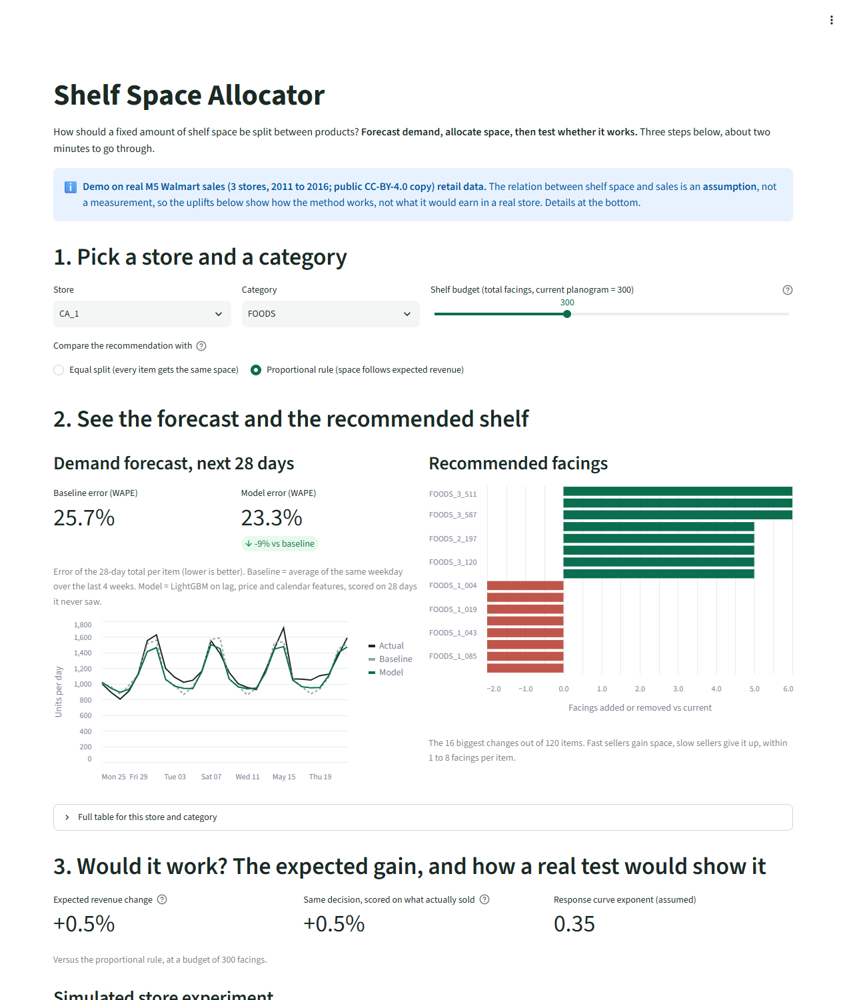

# Shelf Space Allocator

**Live demo: https://shelf.manarattar.com**

A small end-to-end data science product for a retail commerce problem: *how should a fixed amount of
shelf space be split between products?* It forecasts demand, allocates space under constraints, and
shows how a real store experiment would be designed and powered.



> **Read this first.** The demo runs on the **real public M5 (Walmart) sales data** (3 stores, 3
> categories, 300 best-selling items, 2011 to 2016). Public data has no shelf plans, so the link
> between shelf space and sales is an **assumption** (`sales = demand × (space / current space)^α`),
> not a measurement. The forecast numbers are measured on real held-out sales; the revenue uplifts
> show how the method works, not what it would earn in a real store. A synthetic generator with the
> same schema is included for tests and offline use.

## What it does

| Step | What | Where |
|---|---|---|
| 1 | PySpark pipeline: load, subset, melt to long format, lag / rolling / price / calendar features | `src/shelfspace/data.py` |
| 2 | Direct 28-day-ahead forecast, LightGBM against a seasonal-naive baseline, WAPE and MASE | `src/shelfspace/forecast.py` |
| 3 | Allocate integer shelf facings per item to maximise expected revenue (greedy marginal gain, optimal for this concave objective, tested against brute force) | `src/shelfspace/optimise.py` |
| 4 | Simulated store A/B test: pre/post change per store, confidence interval, power and required sample size | `src/shelfspace/experiment.py` |
| 5 | One-page Streamlit app: pick, see, result | `app/streamlit_app.py` |

Heavy work (Spark and training) runs offline and writes small files to `results/`. The live app only
reads those and runs the fast optimiser, so no Spark in production.

## Results (real M5 data, 900 store-item series, 28-day holdout 25 Apr to 22 May 2016)

| Forecast error (WAPE, lower is better) | Seasonal naive | LightGBM |
|---|---|---|
| 28-day total per item (what the shelf decision uses) | 26.0% | **23.9%** |
| Daily per item | 58.4% | **53.4%** |

Daily item-level error is high because most items sell a few units a day (count noise); totals over
28 days average much of it out. The model wins on WAPE in every category and on MASE overall
(1.01 against 1.08). Full numbers in `results/metrics.json`.

| Shelf allocation uplift in expected revenue (mean of 3 stores) | FOODS | HOUSEHOLD | HOBBIES |
|---|---|---|---|
| vs equal split (stylised "current") | +20.6% | +10.6% | +10.3% |
| vs proportional-to-revenue rule | +0.5% | +0.3% | +0.4% |

The honest reading: most of the gain comes from not splitting space equally. Against a sensible rule
the optimiser adds well under 1%, and a change that small would need roughly 2,400 to 8,400 stores
per arm to confirm in a store test (about 30 stores per arm can only detect effects above about 4%).
The app lets you switch between both comparisons and shows the power calculation.

The allocation is chosen from the forecast and then re-scored with what actually sold in the held-out
window ("backtest"), so forecast error cannot quietly inflate the number.

## Design choices

- **No leakage.** Every sales feature is at least 28 days older than the target day (direct
  multi-horizon forecasting, no recursion). A test checks the Spark lags against the raw series.
- **Baselines first.** Seasonal naive is the yardstick, and a CI quality gate fails if LightGBM does
  not beat it.
- **Packages, not notebooks.** Installable package, 36 tests, ruff, CI. No notebooks.
- **Honest comparators.** The "current" planogram is an equal split; the fairer comparison is the
  proportional rule, which is the default in the app.

## Run it

```bash
pip install -e ".[app,train,dev]"
python scripts/make_synthetic.py        # or put the real M5 csv files in data/raw/ (see below)
python -m shelfspace.pipeline           # Spark + LightGBM, writes results/ (~3 min)
streamlit run app/streamlit_app.py
pytest -q                               # add -m "not spark" to skip the Java-dependent tests
```

Spark needs Java 8, 11 or 17. On a small machine the pipeline runs Spark in local mode with a 1 GB
heap (`get_spark` in `data.py`).

## Using real M5 data

The published results use the real M5 files (`calendar.csv`, `sales_train_evaluation.csv`,
`sell_prices.csv`), put in `data/raw/` (git-ignored). The competition is on
[Kaggle](https://www.kaggle.com/competitions/m5-forecasting-accuracy/data); a CC-BY-4.0 copy of the
same archive is on [Zenodo](https://zenodo.org/records/12636070). The pipeline keeps the
best-selling items per category for 3 stores (`config.py`). The synthetic generator uses the same
schema.

## What I would do with real data

- Replace the assumed response curve with one estimated from planogram history or a store test.
- Optimise margin rather than revenue, and add substitution between items.
- Add store-specific space limits and supplier constraints.
- Run the Spark job on Azure Databricks and schedule it.

For a non-technical summary see [docs/for-category-managers.md](docs/for-category-managers.md).
